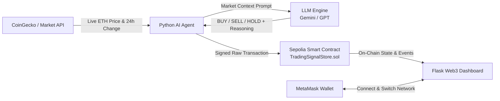

# AI Trading Signal Agent Demo

An end-to-end autonomous AI cryptocurrency trading signal agent deployed on **Ethereum Sepolia Testnet**.

The system fetches live market data from **CoinGecko**, invokes an **LLM** (Google Gemini or OpenAI) to formulate a trading recommendation (`BUY`, `SELL`, or `HOLD`), immutably records the decision onto a **Solidity smart contract on Sepolia**, and displays live signals with **MetaMask wallet integration** on a responsive Flask Web3 dashboard.

---

## Architecture Flow



1. **Market Data Feed**: Fetches real-time ETH/USD price, 24-hour percentage change, and trading volume from CoinGecko API (with resilient failover to Binance/Coinbase feeds).
2. **AI Reasoning Engine**: Submits prompt to LLM (`gemini-2.5-flash` or `gpt-4o-mini`) requesting a quantitative conviction decision (`BUY`, `SELL`, or `HOLD`) with strict JSON schema and concise market reasoning.
3. **On-Chain Recording**: Uses `web3.py` and a funded Ethereum private key to sign and broadcast the transaction to the `TradingSignalStore` smart contract on Sepolia testnet.
4. **Flask Web3 Frontend**: Connects MetaMask, displays network status (verifies Sepolia Chain ID `11155111`), streams live market data, renders on-chain signal history, and provides a 1-click trigger button with execution feedback.

---

## Tech Stack

- **Smart Contract**: Solidity `^0.8.20`, compiled with `solc`
- **Blockchain Network**: Ethereum Sepolia Testnet (Chain ID: `11155111`)
- **Backend / Web3**: Python 3.14 / 3.10+, `web3.py` (v7+), `eth-account`, `requests`
- **LLM Providers**: Google Gemini API (`google-genai`), OpenAI API (`openai`), plus an intelligent algorithmic momentum model fallback
- **Market Data**: CoinGecko API (Free & Pro support) + failover tickers
- **Frontend**: Flask, HTML5, Modern CSS (Cyberpunk dark fintech theme), Vanilla JS, and `ethers.js` for MetaMask wallet connectivity

---

## Project Structure

```
├── contracts/
│   └── TradingSignalStore.sol     # Solidity contract storing trading decisions
├── compiled/
│   └── TradingSignalStore.json    # Compiled artifact (ABI + EVM bytecode)
├── static/
│   ├── css/
│   │   └── style.css              # Dark theme styling, badges, animations
│   └── js/
│       └── app.js                 # MetaMask connection, price polling, UI triggers
├── templates/
│   └── index.html                 # Web3 dashboard layout
├── agent.py                       # Standalone agent script (CoinGecko -> LLM -> Sepolia)
├── deploy.py                      # Sepolia contract deployment script (Web3.py)
├── deploy_simulated.py            # Local demo configuration generator
├── compile.js                     # Solc contract compilation script
├── app.py                         # Flask application & API routes
├── verify_sepolia.py              # Sepolia connectivity & balance diagnostic tool
├── test_pipeline.py               # Automated unit & integration test suite
├── package.json                   # Solc compiler dependencies
├── requirements.txt               # Python package dependencies
├── .env.example                   # Environment variable template
└── README.md                      # Complete setup & usage instructions
```

---

## Prerequisites

1. **Python 3.10+** (tested on Python 3.14)
2. **Node.js 18+** & **npm** (for compiling the Solidity contract)
3. **MetaMask Browser Extension** (for interacting from the web browser)
4. **Sepolia Testnet ETH** (for contract deployment & on-chain gas)
   - [Google Cloud Web3 Sepolia Faucet](https://cloud.google.com/application/web3/faucet/ethereum/sepolia)
   - [Sepolia PoW Faucet](https://sepolia-faucet.pk910.de/)
   - [Infura Sepolia Faucet](https://www.infura.io/faucet/sepolia)
   - [Alchemy Sepolia Faucet](https://sepoliafaucet.com/)

---

## Installation & Setup

### 1. Clone & Enter the Directory

```bash
cd /Users/munavathvijay/Desktop/samplePrototypes
```

### 2. Set Up Python Virtual Environment

```bash
python3 -m venv venv
source venv/bin/activate
pip install -r requirements.txt
```

### 3. Install Compiler Dependencies

```bash
npm install
```

### 4. Configure Environment Variables

Copy `.env.example` to `.env`:

```bash
cp .env.example .env
```

Open `.env` and fill in your values:

```ini
# Ethereum Sepolia Testnet RPC (defaults to public node)
SEPOLIA_RPC_URL=https://ethereum-sepolia-rpc.publicnode.com

# Private key of your Sepolia wallet (funded with SepoliaETH)
PRIVATE_KEY=your_private_key_here

# (Optional) LLM API Keys - If left blank, algorithmic momentum mode is used
GEMINI_API_KEY=your_gemini_api_key_here
OPENAI_API_KEY=your_openai_api_key_here

# (Optional) CoinGecko Demo API Key if you have one
COINGECKO_API_KEY=

PORT=5000
```

> **Security Note:** Never commit your `.env` or expose your private key publicly.

---

## Usage Guide

### Step 1: Compile the Smart Contract

Compile `contracts/TradingSignalStore.sol` using solc:

```bash
node compile.js
```
*Output: Generates `compiled/TradingSignalStore.json` with ABI and Bytecode.*

---

### Step 2: Check Sepolia Network & Wallet Balance

Run the diagnostic utility to verify connectivity and account funds:

```bash
python verify_sepolia.py
```

*Example Output:*
```
============================================================
 Sepolia Network Connectivity & Account Checker
============================================================
Connecting to RPC: https://ethereum-sepolia-rpc.publicnode.com...
[✓] Connected to Sepolia successfully!
Chain ID:      11155111 (Expected: 11155111)
Latest Block:  11,809,046
Gas Price:     0.94 Gwei
Account:       0xYourAddress...
SepoliaETH:    0.050000 ETH
[✓] Account has funds! Ready to deploy and submit signals.
============================================================
```

---

### Step 3: Deploy the Contract to Sepolia

Deploy `TradingSignalStore` to Sepolia testnet:

```bash
python deploy.py
```

*What happens:*
- Builds deployment transaction with bytecode and constructor
- Signs transaction with `PRIVATE_KEY`
- Broadcasts to Sepolia testnet and waits for receipt
- Prints Etherscan transaction link and contract address
- Automatically updates `contract_config.json`

*(Optional Demo Mode: If you want to test the UI immediately without Sepolia gas, run `python deploy_simulated.py`)*

---

### Step 4: Run the Standalone Python AI Agent

Execute the agent pipeline directly from the command line:

```bash
python agent.py
```

*What happens:*
1. Fetches current ETH price from CoinGecko API (e.g., `$2,674.50`)
2. Sends price and 24h trend to Gemini/OpenAI asking for a `BUY`, `SELL`, or `HOLD` decision
3. Calls `recordSignal()` on the deployed Sepolia contract
4. Displays the transaction hash and Sepolia Etherscan link

---

### Step 5: Start the Flask Web Application

Start the Web3 frontend dashboard:

```bash
python app.py
```

Open your browser at: **`http://127.0.0.1:5050`** (or **`http://localhost:5050`**)

> **Note for macOS Users:** macOS Monterey/Ventura/Sonoma/Sequoia reserves port `5000` for Apple's AirPlay Receiver (ControlCenter), which causes a blank page or connection error on port 5000. This application runs on port **`5050`** by default to prevent conflicts.

#### In the Web UI:
1. **Connect MetaMask**: Click "Connect MetaMask" in the top right.
2. **Network Check**: If you are not on Sepolia (Chain ID `11155111`), the app will display a prompt with a 1-click **"Switch to Sepolia"** button.
3. **Live Market Feed**: Displays real-time ETH price, 24h percentage change, and volume.
4. **Trigger AI Agent**: Click the large **"Trigger AI Agent"** button.
   - Watch the 3-stage stepper:
     - `1. CoinGecko Price` &rarr; `2. LLM Analysis` &rarr; `3. Sepolia On-Chain`
   - View the confirmed transaction link on Sepolia Etherscan!
5. **Latest Decision Card**: Displays the latest on-chain decision (`BUY` in green, `SELL` in red, `HOLD` in yellow), execution price, AI reasoning, and reporter address.
6. **On-Chain Signal History**: Displays a table of all previous recorded decisions directly queried from the smart contract.

---

## Running Automated Tests

Run the full automated test suite covering contract compilation, CoinGecko price feed, LLM prompt formatting, Flask API routes, and agent execution:

```bash
python test_pipeline.py
```

All 5 test suites will execute and output passing results:
```
[✓] Test 1 Passed: Smart contract compiled artifact verified.
[✓] Test 2 Passed: Fetched ETH price from CoinGecko/feed
[✓] Test 3 Passed: Signal generated with confidence & reasoning
[✓] Test 4 Passed: Flask UI and API endpoints are responsive
[✓] Test 5 Passed: Full trigger -> decision -> state query flow verified.
----------------------------------------------------------------------
Ran 5 tests in 29.866s

OK
```

---

## Smart Contract Specification (`TradingSignalStore.sol`)

### Struct: `Signal`
```solidity
struct Signal {
    uint256 id;
    uint256 timestamp;
    string asset;         // "ETH/USD"
    uint256 price;        // price in cents (e.g. $2674.50 -> 267450)
    string decision;      // "BUY", "SELL", or "HOLD"
    string reasoning;     // LLM rationale
    address reporter;     // agent wallet address
}
```

### Key Functions
- `recordSignal(string asset, uint256 price, string decision, string reasoning)`: Stores a new decision on-chain and emits `SignalRecorded`.
- `getLatestSignal()`: Returns the most recently recorded trading signal.
- `getSignalCount()`: Returns total signals recorded.
- `getRecentSignals(uint256 count)`: Returns up to `count` latest signals in reverse chronological order.
- `getSignal(uint256 index)`: Returns a specific signal by index.

---

## License

MIT License. Built for demonstration and educational purposes.
